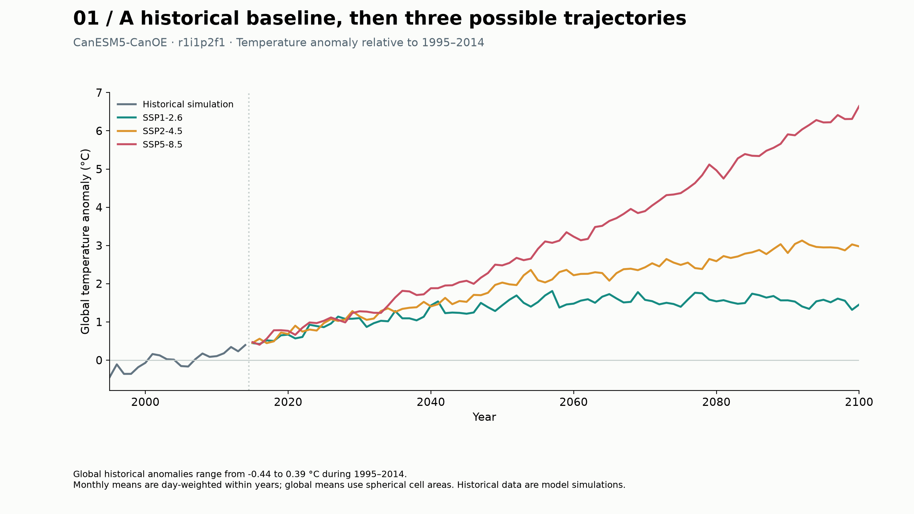
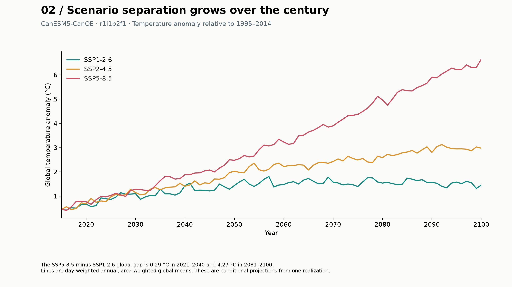
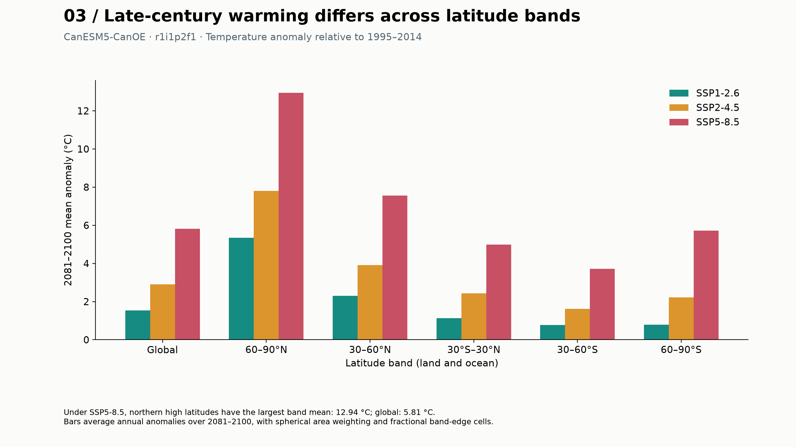
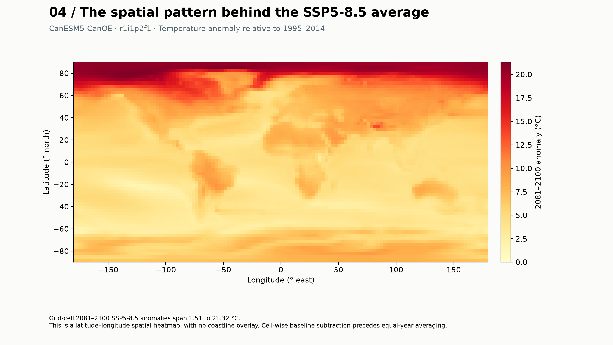
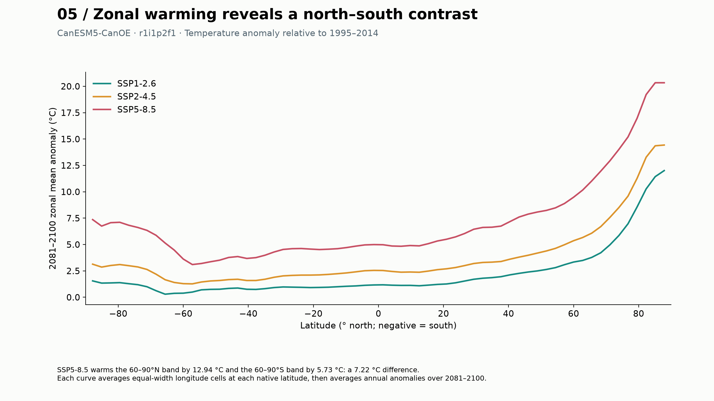
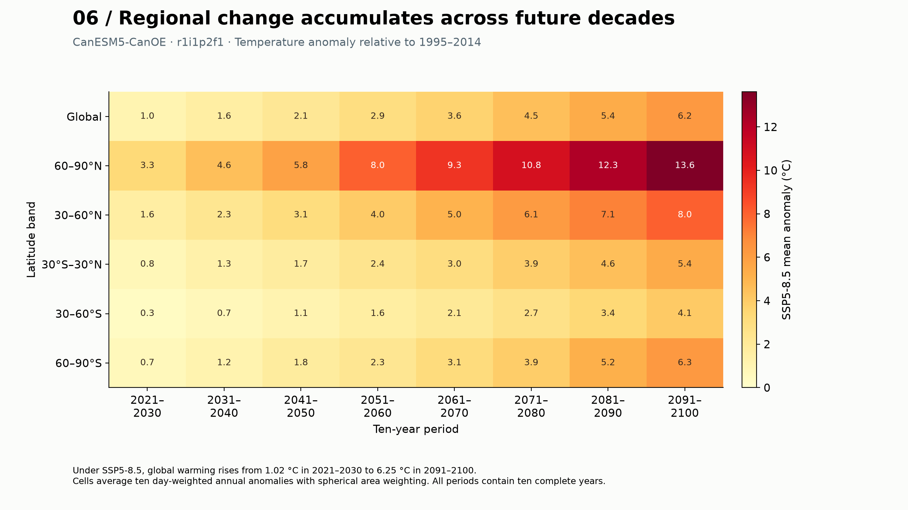

# Exploratory findings

All results use CanESM5-CanOE, r1i1p2f1, relative to 1995–2014. They describe one simulated realization.

## Figure 1

Global historical anomalies range from -0.44 to 0.39 °C during 1995–2014.
Monthly means are day-weighted within years; global means use spherical cell areas. Historical data are model simulations.

## Figure 2

The SSP5-8.5 minus SSP1-2.6 global gap is 0.29 °C in 2021–2040 and 4.27 °C in 2081–2100.
Lines are day-weighted annual, area-weighted global means. These are conditional projections from one realization.

## Figure 3

Under SSP5-8.5, northern high latitudes have the largest band mean: 12.94 °C; global: 5.81 °C.
Bars average annual anomalies over 2081–2100, with spherical area weighting and fractional band-edge cells.

## Figure 4

Grid-cell 2081–2100 SSP5-8.5 anomalies span 1.51 to 21.32 °C.
This is a latitude–longitude spatial heatmap, with no coastline overlay. Cell-wise baseline subtraction precedes equal-year averaging.

## Figure 5

SSP5-8.5 warms the 60–90°N band by 12.94 °C and the 60–90°S band by 5.73 °C: a 7.22 °C difference.
Each curve averages equal-width longitude cells at each native latitude, then averages annual anomalies over 2081–2100.

## Figure 6

Under SSP5-8.5, global warming rises from 1.02 °C in 2021–2030 to 6.25 °C in 2091–2100.
Cells average ten day-weighted annual anomalies with spherical area weighting. All periods contain ten complete years.

